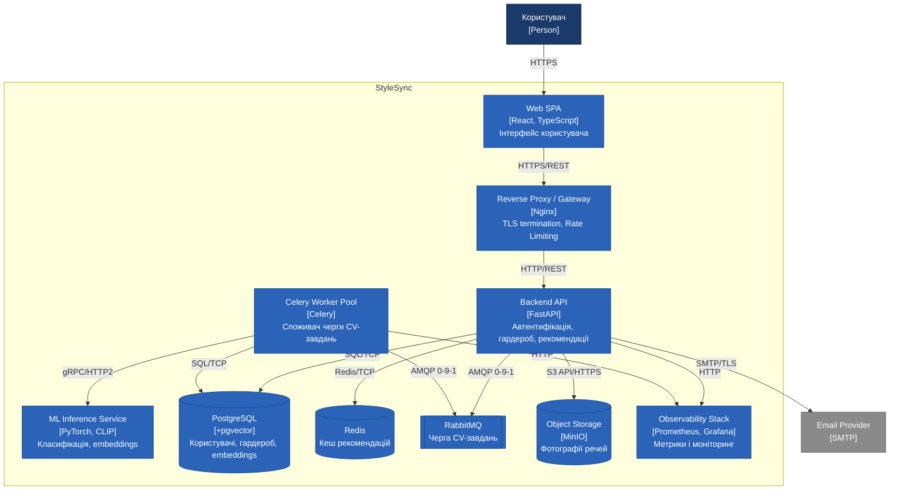
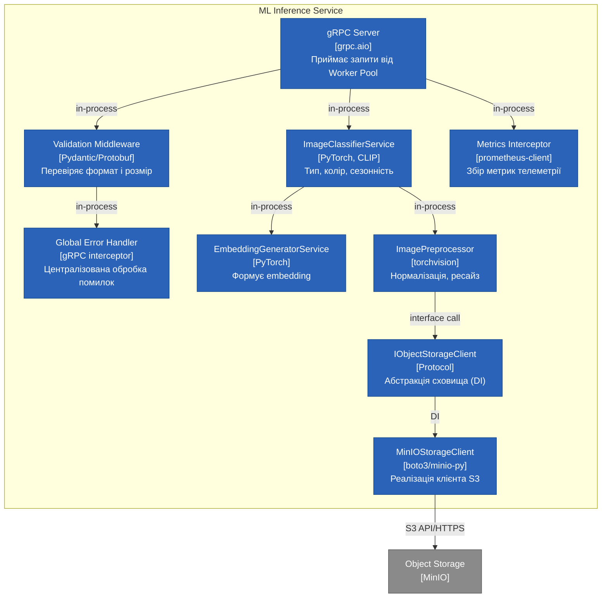
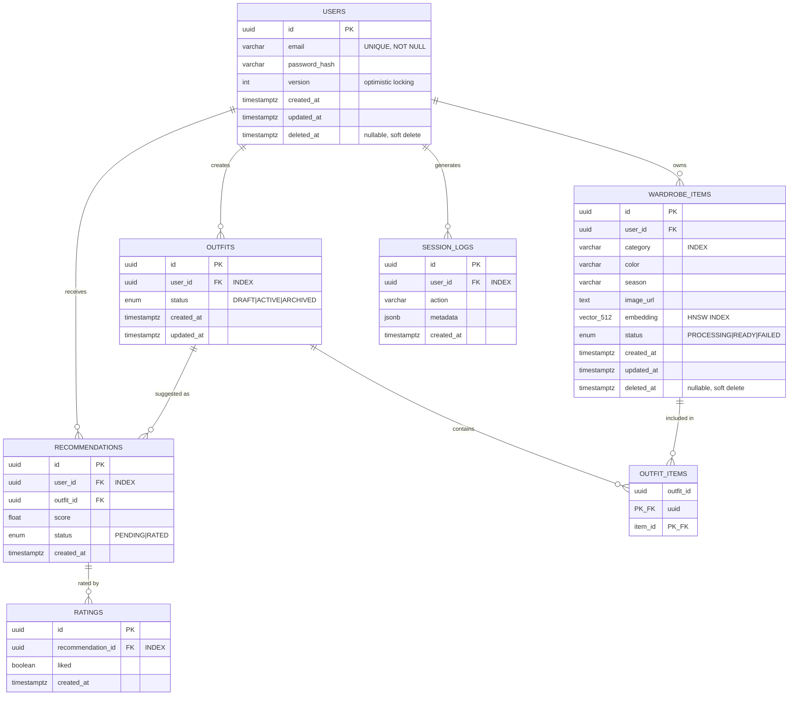
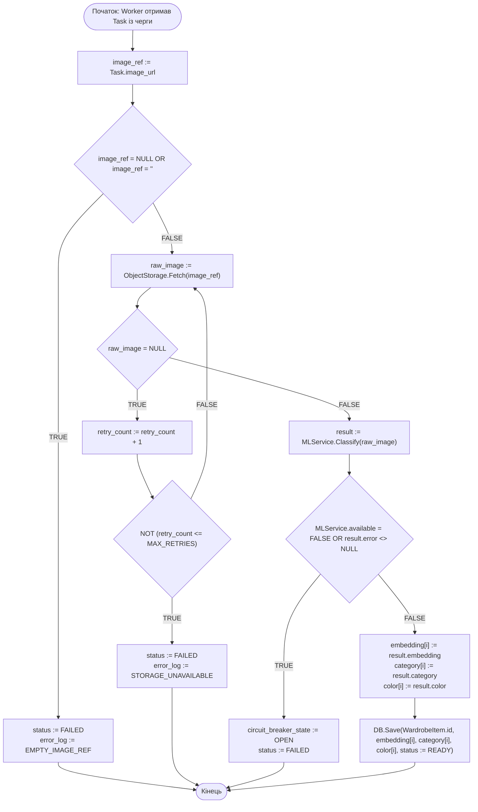
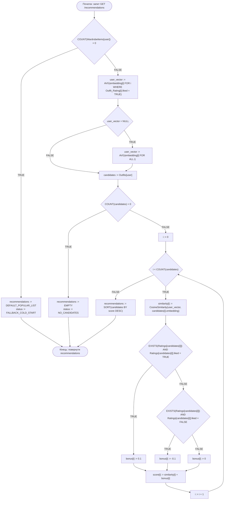

# Розділ 2. Проєктування архітектури системи

## 2.1 Контекстне та контейнерне моделювання системи (C4 Model)

### C4 Level 1 — System Context Diagram

Опис вузлів: актор **Користувач** — єдиний тип кінцевого користувача системи, взаємодіє через веб-браузер. Система **StyleSync** — межі проєкту кваліфікаційної роботи. Зовнішня система **Email Provider** — єдина стороння залежність MVP, винесена за межі системи.

### C4 Level 2 — Container Diagram

Протоколи взаємодії: SPA → Gateway (HTTPS/REST), Gateway → Backend API (HTTP/REST внутрішньо), Backend API → PostgreSQL (SQL/TCP), Backend API → Redis (Redis Protocol/TCP), Backend API → Object Storage (S3 API/HTTPS), Backend API → RabbitMQ (AMQP 0-9-1), Worker → ML Inference Service (gRPC/HTTP2), Backend API → Email Provider (SMTP/TLS).

Трасування вимог: контейнер **Backend API** [C4 Container](#c4-level-2-container-diagram) реалізує функціональні вимоги [SRS-FUN-01](./srs.md#2-functional-requirements), [SRS-FUN-02a](./srs.md#2-functional-requirements), [SRS-FUN-05](./srs.md#2-functional-requirements), [SRS-FUN-06](./srs.md#2-functional-requirements) та базується на рішенні [ADR-001](./adr/0001-choice-of-technology.md) щодо зберігання embeddings у PostgreSQL. Контейнер **ML Inference Service** реалізує [SRS-FUN-03](./srs.md#2-functional-requirements). Контейнер **Reverse Proxy / API Gateway** реалізує нефункціональну вимогу [SRS-NFR-SEC-03](./srs.md#3-non-functional-requirements) (Rate Limiting). Контейнер **RabbitMQ + Celery Worker Pool** реалізує [SRS-NFR-REL-01](./srs.md#3-non-functional-requirements) та [SRS-NFR-REL-02](./srs.md#3-non-functional-requirements) (retry та Circuit Breaker).

---

## 2.2 Компонентне моделювання критичного сервісу системи (C4 Model: Component)

Обрано для деталізації **ML Inference Service** — найскладніший за обчислювальним навантаженням контейнер системи.

Опис компонентів: **gRPC Server** — вхідний шар (Inbound), приймає запити виключно від Celery Worker Pool у межах довіреної внутрішньої мережі (публічна автентифікація JWT виконується на рівні Reverse Proxy/Backend API, повторна перевірка JWT на цьому внутрішньому сервісі визнана надлишковою для обсягу MVP — внутрішня мережа ізольована мережевим рівнем Docker). **Request Validation Middleware** та **Global Error Handler** — шар захисту вхідних даних, еквівалент Guards/Middlewares. **ImageClassifierService** та **EmbeddingGeneratorService** — шар бізнес-логіки (Core/Services). **IObjectStorageClient** — інтерфейсна абстракція, що реалізує принцип інверсії залежностей (Dependency Inversion Principle): **ImagePreprocessor** залежить від абстракції, а не від конкретної реалізації **MinIOStorageClient**, що дозволяє підміняти сховище без зміни бізнес-логіки. **Metrics Interceptor** — наскрізний компонент телеметрії.

Трасування: цей розподіл компонентів реалізує нефункціональну вимогу [SRS-NFR-PERF-02](./srs.md#3-non-functional-requirements) (латентність обробки CV-завдання) та спирається на рішення [ADR-001](./adr/0001-choice-of-technology.md) щодо відокремлення зберігання даних від обчислювальної логіки.

## 2.3 Документування архітектурних рішень (Architecture Decision Records)

Повний текст рішення — [ADR-001: Вибір сховища для векторних embeddings](./adr/0001-choice-of-technology.md) (статус: **Approved**).

## 2.4. Проєктування та моделювання баз даних

**Специфікація полів (вибірково):**

| Таблиця | Поле | Тип | Обмеження | Опис |
|---|---|---|---|---|
| users | id | UUID | PK | Унікальний ідентифікатор користувача |
| users | email | VARCHAR(255) | UNIQUE, NOT NULL | Логін користувача |
| users | version | INT | DEFAULT 1 | Оптимістичне блокування при конкурентних оновленнях профілю |
| wardrobe_items | embedding | VECTOR(512) | HNSW INDEX | Векторне представлення зображення для пошуку схожості (pgvector) |
| wardrobe_items | status | ENUM | PROCESSING/READY/FAILED | Стан асинхронної ML-обробки речі |
| wardrobe_items | deleted_at | TIMESTAMPTZ | NULLABLE | Soft delete — збереження історії образів, де річ вже використана |
| outfits | status | ENUM | DRAFT/ACTIVE/ARCHIVED | Життєвий цикл сформованого образу |
| outfit_items | (outfit_id, item_id) | UUID, UUID | COMPOSITE PK | Унеможливлює дублювання речі в тому самому образі |
| recommendations | status | ENUM | PENDING/RATED | Чи вже оцінена рекомендація користувачем |

Трасування: схема реалізує функціональні вимоги [SRS-FUN-02a, SRS-FUN-04, SRS-FUN-05, SRS-FUN-06, SRS-FUN-07](./srs.md) та деталізує контейнер **PostgreSQL [+pgvector]** з підрозділу 2.1.

## 2.5. Специфікація міжсервісних контрактів (API)

Деталізовану специфікацію ендпоінтів взаємодії Web SPA → Backend API у форматі OpenAPI 3.0 зафіксовано у файлі [openapi.yaml](./api/openapi.yaml). Контракт покриває автентифікацію (OAuth 2.0/OIDC, JWT Bearer), завантаження речі гардероба на асинхронну обробку та отримання персоналізованих рекомендацій, з повною схемою обробки помилок (400/401/429) та механізмом авторизації.

## 2.6. Моделювання логіки критичних вузлів системи

### Алгоритм 1. Пайплайн класифікації фото та генерації embedding (ML Inference)

### Алгоритм 2. Розрахунок персоналізованих рекомендацій

Трасування: Алгоритм 1 реалізує [SRS-FUN-03, SRS-FUN-04](./srs.md) та [SRS-NFR-REL-01/02](./srs.md) (retry-політика, Circuit Breaker). Алгоритм 2 реалізує [SRS-FUN-05, SRS-FUN-06](./srs.md).

## 2.7. Інтеграційний аудит та верифікація цілісності доменів

**Виявлені розбіжності:**

1. **API-to-Database Mismatch.** Схема `WardrobeItem` в OpenAPI-контракті (2.5) містить поле `status: PROCESSING|READY|FAILED`, а в початковій ERD-схемі (2.4, до рефакторингу) поле `status` у таблиці `WARDROBE_ITEMS` було відсутнє.
2. **Logic-to-Data Mismatch.** Алгоритм 2 (2.6) у початковій версії звертався до поля `liked` безпосередньо на `WARDROBE_ITEMS`, тоді як за ERD-схемою оцінка (`RATINGS.liked`) прив'язана до `RECOMMENDATIONS`/`OUTFITS`.

**Усунення розбіжностей:** у фінальну ERD-схему (2.4) додано поле `status ENUM(PROCESSING, READY, FAILED)` до `WARDROBE_ITEMS`; формулу Алгоритму 2 (2.6) скориговано — `user_vector` обчислюється через `Outfit_Rating[i].liked` (зв'язок `OUTFITS → RECOMMENDATIONS → RATINGS`).

**Production Readiness Report:** критичних блокерів (Showstoppers) не виявлено. Специфікації даних, API-контрактів та алгоритмів синхронізовані між собою за типами, іменами сутностей та життєвими циклами статусів. Архітектурні артефакти Розділу 2 готові до передачі в розробку (Розділ 3).
