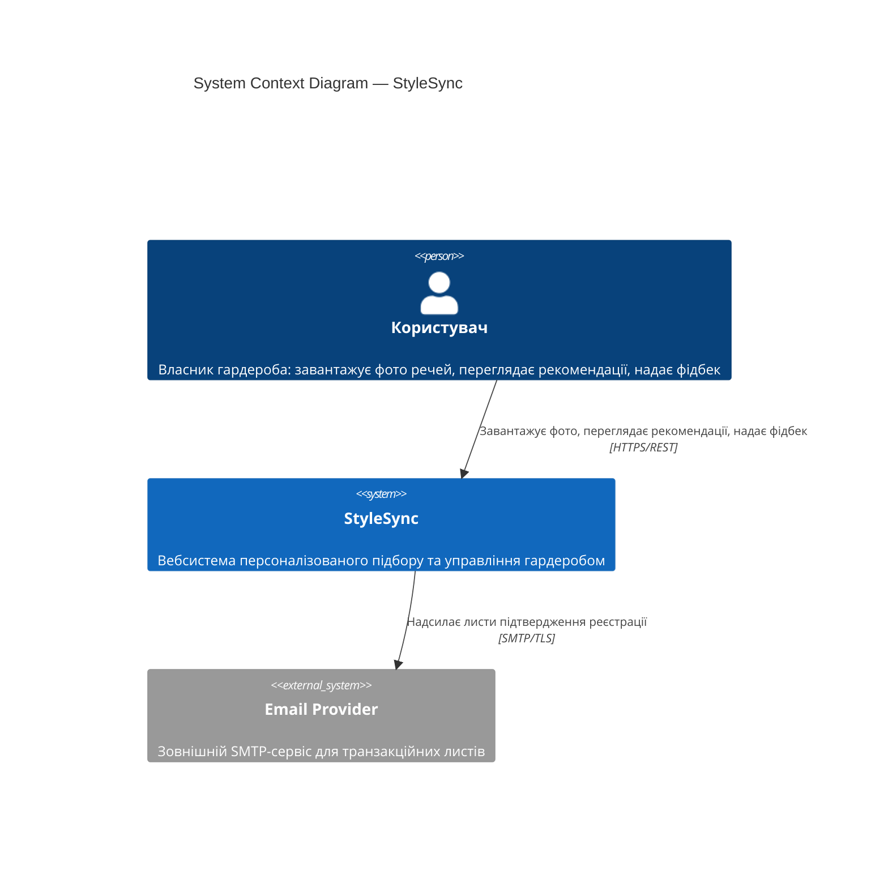
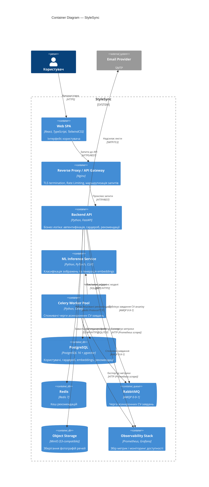
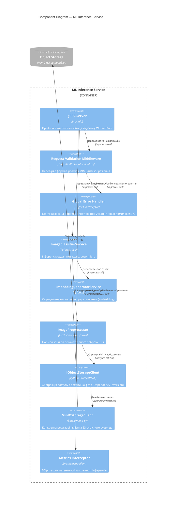

# Розділ 2. Проєктування архітектури системи

## 2.1 Контекстне та контейнерне моделювання системи (C4 Model)

### C4 Level 1 — System Context Diagram

Опис вузлів: актор **Користувач** — єдиний тип кінцевого користувача системи, взаємодіє через веб-браузер. Система **StyleSync** — межі проєкту кваліфікаційної роботи. Зовнішня система **Email Provider** — єдина стороння залежність MVP, винесена за межі системи.

### C4 Level 2 — Container Diagram

Протоколи взаємодії: SPA → Gateway (HTTPS/REST), Gateway → Backend API (HTTP/REST внутрішньо), Backend API → PostgreSQL (SQL/TCP), Backend API → Redis (Redis Protocol/TCP), Backend API → Object Storage (S3 API/HTTPS), Backend API → RabbitMQ (AMQP 0-9-1), Worker → ML Inference Service (gRPC/HTTP2), Backend API → Email Provider (SMTP/TLS).

Трасування вимог: контейнер **Backend API** [C4 Container](#c4-level-2-container-diagram) реалізує функціональні вимоги [SRS-FUN-01](./srs.md#2-functional-requirements), [SRS-FUN-02a](./srs.md#2-functional-requirements), [SRS-FUN-05](./srs.md#2-functional-requirements), [SRS-FUN-06](./srs.md#2-functional-requirements) та базується на рішенні [ADR-001](./adr/0001-choice-of-technology.md) щодо зберігання embeddings у PostgreSQL. Контейнер **ML Inference Service** реалізує [SRS-FUN-03](./srs.md#2-functional-requirements). Контейнер **Reverse Proxy / API Gateway** реалізує нефункціональну вимогу [SRS-NFR-SEC-03](./srs.md#3-non-functional-requirements) (Rate Limiting). Контейнер **RabbitMQ + Celery Worker Pool** реалізує [SRS-NFR-REL-01](./srs.md#3-non-functional-requirements) та [SRS-NFR-REL-02](./srs.md#3-non-functional-requirements) (retry та Circuit Breaker).

---

## 2.2 Компонентне моделювання критичного сервісу системи (C4 Model: Component)

Обрано для деталізації **ML Inference Service** — найскладніший за обчислювальним навантаженням контейнер системи.

Опис компонентів: **gRPC Server** — вхідний шар (Inbound), приймає запити виключно від Celery Worker Pool у межах довіреної внутрішньої мережі (публічна автентифікація JWT виконується на рівні Reverse Proxy/Backend API, повторна перевірка JWT на цьому внутрішньому сервісі визнана надлишковою для обсягу MVP — внутрішня мережа ізольована мережевим рівнем Docker). **Request Validation Middleware** та **Global Error Handler** — шар захисту вхідних даних, еквівалент Guards/Middlewares. **ImageClassifierService** та **EmbeddingGeneratorService** — шар бізнес-логіки (Core/Services). **IObjectStorageClient** — інтерфейсна абстракція, що реалізує принцип інверсії залежностей (Dependency Inversion Principle): **ImagePreprocessor** залежить від абстракції, а не від конкретної реалізації **MinIOStorageClient**, що дозволяє підміняти сховище без зміни бізнес-логіки. **Metrics Interceptor** — наскрізний компонент телеметрії.

Трасування: цей розподіл компонентів реалізує нефункціональну вимогу [SRS-NFR-PERF-02](./srs.md#3-non-functional-requirements) (латентність обробки CV-завдання) та спирається на рішення [ADR-001](./adr/0001-choice-of-technology.md) щодо відокремлення зберігання даних від обчислювальної логіки.

## 2.3 Документування архітектурних рішень (Architecture Decision Records)

Повний текст рішення — [ADR-001: Вибір сховища для векторних embeddings](./adr/0001-choice-of-technology.md) (статус: **Approved**).
